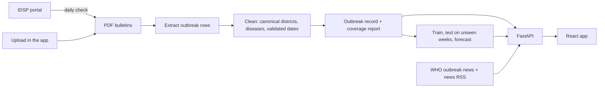

# SentinelGIS

District-level outbreak surveillance and forecasting for India, built on the weekly outbreak reports published by the Integrated Disease Surveillance Programme (IDSP), Ministry of Health & Family Welfare.

SentinelGIS reads the official PDF bulletins, turns them into a clean outbreak record, maps it, and estimates where outbreaks are most likely to be reported next. Every figure on screen is traceable to a bulletin, and the forecast is shown together with how it performed when tested.

**It is decision support. It does not replace field surveillance or the judgement of public-health officers.**

## What it does

| Page | What you see | Where it comes from |
| --- | --- | --- |
| **Surveillance** | Outbreaks, cases and deaths per district for the latest weeks or a calendar year | IDSP weekly outbreak reports |
| **Forecast** | Probability that an outbreak of a disease is reported in each district in the next 4 weeks, with the facts behind each number; and districts bordering a current outbreak | Model trained on the outbreak record |
| **Analytics** | Monthly trend (gaps shown as gaps), districts with unusually high case counts, diseases reported together | Outbreak record |
| **Live signals** | WHO Disease Outbreak News (official) and recent news headlines (unverified), mapped to the states they mention | WHO API, news RSS |
| **Data & model** | Data currency and coverage week by week, how outbreaks are placed on the map, the model's test results and limitations | Generated by the pipeline |

A banner on every page states how old the newest bulletin is, so past data is never mistaken for the present situation.

## How the data flows



1. **Ingest.** The server checks the IDSP portal daily and on start-up; any PDF dropped into `backend/idsp_pdfs/` or uploaded with *Add IDSP bulletin* is picked up within a minute.
2. **Extract.** `backend/data/pdf_extractor.py` reads every outbreak row (Unique ID, state, district, disease, cases, deaths, dates, status).
3. **Clean.** `backend/data/clean_data.py` resolves district names to the boundary layer, normalises disease names, validates dates against the reporting week and merges follow-up rows. What could not be resolved is recorded in `backend/data/data_quality.json`, never guessed.
4. **Model.** `backend/app/services/ml_trainer.py` retrains, re-tests and re-forecasts after every change to the data.

## The forecast, honestly

- **Target:** at least one outbreak of a disease reported for a district within 4 weeks. It does not predict case counts.
- **Model:** gradient-boosted trees on the district's own history, its neighbours, the rest of the state and the season. Only information available at forecast time is used, and weeks without a bulletin are treated as unknown, not as quiet.
- **Testing:** hyperparameters are tuned on older weeks; the reported scores come from the most recent labelled weeks, which the model never saw.
- **Result on the current data** (test period Oct 2025 to Jan 2026, 117,600 forecasts, 1.4% followed by an outbreak):

| Risk tier | Outbreak actually followed | Share of all outbreaks |
| --- | --- | --- |
| High (20%+) | 34% | 11% |
| Medium (8%+) | 15% | 18% |
| Low (3%+) | 5.5% | 26% |
| Minimal | 0.7% | 45% |

Average precision 0.160 against 0.109 for the best simple rule (frequency over the last year); ROC-AUC 0.86. In plain terms: the tiers mean what they say and the ranking is useful for deciding where to look first, but most flags are not followed by an outbreak and nearly half of outbreaks occur where risk was rated Minimal. The live numbers, per-disease results and limitations are on the **Data & model** page and in `backend/data/model_card.json`.

## Known limitations

- **Coverage has gaps.** The repository holds 148 weekly bulletins between January 2021 and February 2026; 120 weeks in that span are missing (most of 2024, the second half of 2021). Run the server where the IDSP portal is reachable, or upload the missing PDFs, to fill them.
- **Reported outbreaks only.** An outbreak a state did not report is invisible, and states that report thoroughly look riskier.
- **Boundaries are from 2021.** Districts created later are shown on the district they were carved from.
- **Live signals are text matches.** A state is highlighted because a notice or headline names it.
- **Guidance text** is a summary of the linked WHO/CDC fact sheets and should be reviewed by a clinician before operational use.

## Quick start

```bash
# Backend (Python 3.10+)
cd backend
python -m venv venv && source venv/bin/activate
pip install -r requirements.txt
uvicorn app.main:app --reload          # http://127.0.0.1:8000, API docs at /docs

# Frontend (Node 18+)
cd frontend
npm install
npm start                              # http://localhost:3000
```

The repository ships with the extracted outbreak record, a trained model and the current forecast, so the app works immediately. To rebuild everything from the PDFs:

```bash
cd backend
rm data/historical_cases_raw.csv       # forces a full re-extraction (about 2 minutes)
python -m app.services.pipeline_runner # scrape, extract, clean, train, forecast
python -m unittest discover -s tests   # parsing, cleaning, name matching, no-leakage checks
```

Production: `docker build -t sentinelgis . && docker run -p 8000:8000 sentinelgis` serves the API and the built frontend on one port; `deploy/setup_vps.sh` sets up Nginx and systemd on Ubuntu.

## Configuration

Paths, thresholds, schedules and URLs all have defaults that can be overridden.

| What | Where | How to override |
| --- | --- | --- |
| Backend paths, burden bands, forecast horizon and tiers, staleness threshold, scheduler, scraper, upload limit, CORS | `backend/app/config.py` | Environment variable of the same name (e.g. `FORECAST_HORIZON_WEEKS=4`, `DATA_STALE_AFTER_DAYS=21`, `ENABLE_SCHEDULER=false`) |
| Live feeds, state and city names, disease keywords, non-transmissible diseases, sourced guidance text | `backend/app/resources/realtime.json` | Edit the file, or point `REALTIME_CONFIG_PATH` at your own |
| District renamings and parent districts | `backend/app/resources/district_aliases.json` | Edit the file (targets are validated against the gazetteer) |
| API URL, map view, optional background tiles, polling interval, default disease, palette | `frontend/src/config.js` | `REACT_APP_*` variables, see `frontend/.env.example` |
| Install dir, port, domain, service user, worker count | `deploy/setup_vps.sh` | e.g. `sudo SERVER_NAME=sentinel.example.com bash deploy/setup_vps.sh` |

Set `ADMIN_API_KEY` on the backend to require an `X-API-Key` header on the upload and pipeline-trigger endpoints (they are open when it is unset).

## Repository layout

- `backend/app/routes/` API endpoints: surveillance, forecast, analytics, neighbour exposure, live signals.
- `backend/app/services/` forecasting (`forecasting.py`, `ml_trainer.py`), name resolution (`gazetteer.py`), live feeds, pipeline runner.
- `backend/data/` ingestion scripts and the generated datasets (`historical_cases_clean.csv`, `forecast_latest.csv`, `model_card.json`, `data_quality.json`).
- `backend/idsp_pdfs/` the source bulletins.
- `backend/tests/` unit tests.
- `build_boundaries.py` rebuilds the map layers, district gazetteer and adjacency from geoBoundaries.
- `frontend/src/` React app (`pages/`, `components/`, `hooks/`, `config.js`).

## Data sources and licences

- Outbreak data: [IDSP Weekly Outbreak Reports](https://idsp.mohfw.gov.in), Government of India.
- District boundaries (2021): [geoBoundaries](https://www.geoboundaries.org), from the Local Government Directory, ODbL 1.0. State boundaries: DataMeet India community, CC BY 2.5 IN.
- Live signals: [WHO Disease Outbreak News](https://www.who.int/emergencies/disease-outbreak-news); Google News RSS.
- Guidance: WHO and CDC fact sheets, linked from each entry.
