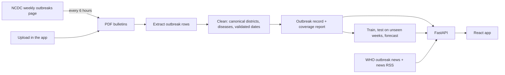

# SentinelGIS

District-level outbreak surveillance and forecasting for India, built on the weekly outbreak reports published by the Integrated Disease Surveillance Programme (IDSP), Ministry of Health & Family Welfare.

SentinelGIS reads the official PDF bulletins, turns them into a clean outbreak record, maps it, and estimates where outbreaks are most likely to be reported next. Every figure on screen is traceable to a bulletin, and the forecast is shown together with how it performed when tested.

**It is decision support. It does not replace field surveillance or the judgement of public-health officers.**

## What it does

| Page | What you see | Where it comes from |
| --- | --- | --- |
| **Reported** | Outbreaks, cases and deaths per district for the latest weeks or a calendar year | IDSP weekly outbreak reports |
| **Forecast** | Probability that an outbreak of a disease is reported in each district in the next 4 weeks, with the facts behind each number; and districts bordering a current outbreak | Model trained on the outbreak record |
| **Trends** | Monthly trend (gaps shown as gaps), districts with unusually high case counts, diseases reported together | Outbreak record |
| **News** | WHO Disease Outbreak News (official) and recent news headlines (unverified), mapped to the states they mention | WHO API, news RSS |
| **About the data** | Data currency and coverage week by week, how outbreaks are placed on the map, the model's test results and limitations | Generated by the pipeline |

A banner on every page states how old the newest bulletin is, so past data is never mistaken for the present situation. Any district can be found from the search box in the header; its panel shows everything it has reported together with its forecast. Lists can be filtered and downloaded as CSV.

## How the data flows



1. **Ingest.** The server checks the official list of weekly reports ([NCDC](https://ncdc.mohfw.gov.in/includes/WeeklyOutbreaks.php); the old idsp.mohfw.gov.in site was retired in 2026) at start-up and every 6 hours, and downloads any bulletin it does not hold. If that site cannot be reached, it reads the Internet Archive's copy of the index and of the same PDF files. Any PDF dropped into `backend/idsp_pdfs/` or uploaded with *Add IDSP bulletin* is picked up within a minute. `backend/idsp_pdfs/manifest.json` records the week and source URL of every file.
2. **Extract.** `backend/data/pdf_extractor.py` reads every outbreak row (Unique ID, state, district, disease, cases, deaths, dates, status). Once a bulletin's rows are safely stored, its PDF is deleted to save space (`DELETE_PDFS_AFTER_EXTRACTION=false` keeps them).
3. **Clean.** `backend/data/clean_data.py` resolves district names to the boundary layer, normalises disease names, validates dates against the reporting week and merges follow-up rows. What could not be resolved is recorded in `backend/data/data_quality.json`, never guessed.
4. **Model.** `backend/app/services/ml_trainer.py` retrains, re-tests and re-forecasts after every change to the data.

## The forecast, honestly

- **Target:** at least one outbreak of a disease reported for a district within 4 weeks. It does not predict case counts.
- **Model:** gradient-boosted trees on the district's own history, its neighbours, the rest of the state and the season. Only information available at forecast time is used, and weeks without a bulletin are treated as unknown, not as quiet.
- **Testing:** hyperparameters are tuned on older weeks; the reported scores come from the most recent labelled weeks, which the model never saw.
- **Result on the current data** (17 diseases; test period April to July 2026, 199,920 forecasts, 1.1% followed by an outbreak):

| Risk tier | Outbreak actually followed | Share of all outbreaks |
| --- | --- | --- |
| High (20%+) | 32% | 17% |
| Medium (8%+) | 9% | 22% |
| Low (3%+) | 4.8% | 28% |
| Minimal | 0.4% | 34% |

Average precision 0.182 against 0.131 for the best simple rule (frequency over the last year); ROC-AUC 0.89. In plain terms: the ranking is useful for deciding where to look first, but most flags are not followed by an outbreak and about a third of outbreaks occur where risk was rated Minimal. Results differ a lot by disease and by season (in this test period: strong for dengue, hepatitis, typhoid and chickenpox; near useless for cholera, leptospirosis and rabies). These figures are regenerated at every retrain: the live numbers, per-disease results and limitations are on the **About the data** page and in `backend/data/model_card.json`.

## Known limitations

- **Data is as current as the official site.** The record holds 13,828 outbreaks from 446 of the 450 weekly bulletins between January 2018 and 16 August 2026, the newest week NCDC had published when this was written (12 October 2026). Publication runs several weeks behind, so the app can never be more current than that.
- **Four weeks are missing** (2018-W33, 2020-W13, 2023-W38, 2024-W13): the official index links each of them to another week's document.
- **Reported outbreaks only.** An outbreak a state did not report is invisible, and states that report thoroughly look riskier.
- **Boundaries are from 2021.** Districts created later are shown on the district they were carved from.
- **Live signals are text matches.** A state is highlighted because a notice or headline names it.
- **Guidance text** is a summary of the linked WHO/CDC fact sheets and should be reviewed by a clinician before operational use.

## Quick start

```bash
# Backend (Python 3.10+)
cd backend
python -m venv venv && source venv/bin/activate
pip install -r requirements.txt
uvicorn app.main:app --reload          # http://127.0.0.1:8000, API docs at /docs

# Frontend (Node 20+; Vite, React 19, Tailwind CSS 4)
cd frontend
npm install
npm run dev                            # http://localhost:3000
npm run build && npm test              # production build into frontend/build, unit tests
```

The repository ships with the extracted outbreak record, a trained model and the current forecast, so the app works immediately. To rebuild everything from the PDFs:

```bash
cd backend
rm idsp_pdfs/manifest.json processed_pdfs.txt data/historical_cases_raw.csv data/bulletins.csv
python -m app.services.pipeline_runner # re-download (~40 min), extract, clean, train (~15 min), forecast
python -m unittest discover -s tests   # scraping, parsing, cleaning, name matching, no-leakage checks
```

Production: `docker build -t sentinelgis . && docker run -p 8000:8000 sentinelgis` serves the API and the built frontend on one port; `deploy/setup_vps.sh` sets up Nginx and systemd on Ubuntu.

## Configuration

Paths, thresholds, schedules and URLs all have defaults that can be overridden.

| What | Where | How to override |
| --- | --- | --- |
| Backend paths, burden bands, forecast horizon and tiers, staleness threshold, scheduler, scraper, upload limit, CORS | `backend/app/config.py` | Environment variable of the same name (e.g. `FORECAST_HORIZON_WEEKS=4`, `DATA_STALE_AFTER_DAYS=21`, `ENABLE_SCHEDULER=false`) |
| Live feeds, state and city names, disease keywords, non-transmissible diseases, sourced guidance text | `backend/app/resources/realtime.json` | Edit the file, or point `REALTIME_CONFIG_PATH` at your own |
| District renamings and parent districts | `backend/app/resources/district_aliases.json` | Edit the file (targets are validated against the gazetteer) |
| API URL, map view, optional background tiles, polling interval, default disease, palette | `frontend/src/config.js` | `VITE_*` variables, see `frontend/.env.example` |
| Install dir, port, domain, service user, worker count | `deploy/setup_vps.sh` | e.g. `sudo SERVER_NAME=sentinel.example.com bash deploy/setup_vps.sh` |

Set `ADMIN_API_KEY` on the backend to require an `X-API-Key` header on the upload and pipeline-trigger endpoints (they are open when it is unset).

## Repository layout

- `backend/app/routes/` API endpoints: surveillance, forecast, analytics, neighbour exposure, live signals.
- `backend/app/services/` forecasting (`forecasting.py`, `ml_trainer.py`), name resolution (`gazetteer.py`), live feeds, pipeline runner.
- `backend/data/` ingestion scripts and the generated datasets (`historical_cases_clean.csv`, `forecast_latest.csv`, `model_card.json`, `data_quality.json`).
- `backend/idsp_pdfs/manifest.json` week and source URL of every bulletin ingested (the PDFs themselves are deleted after extraction).
- `backend/tests/` unit tests.
- `build_boundaries.py` rebuilds the map layers, district gazetteer and adjacency from geoBoundaries.
- `frontend/src/` React app (`pages/`, `components/`, `hooks/`, `config.js`).

## Data sources and licences

- Outbreak data: [IDSP Weekly Outbreak Reports](https://ncdc.mohfw.gov.in/includes/WeeklyOutbreaks.php), National Centre for Disease Control, Government of India; files obtained from the portal, from IDSP's Google Drive links and from [Internet Archive](https://web.archive.org) copies of the portal's files.
- District boundaries (2021): [geoBoundaries](https://www.geoboundaries.org), from the Local Government Directory, ODbL 1.0. State boundaries: DataMeet India community, CC BY 2.5 IN.
- Live signals: [WHO Disease Outbreak News](https://www.who.int/emergencies/disease-outbreak-news); Google News RSS.
- Guidance: WHO and CDC fact sheets, linked from each entry.
